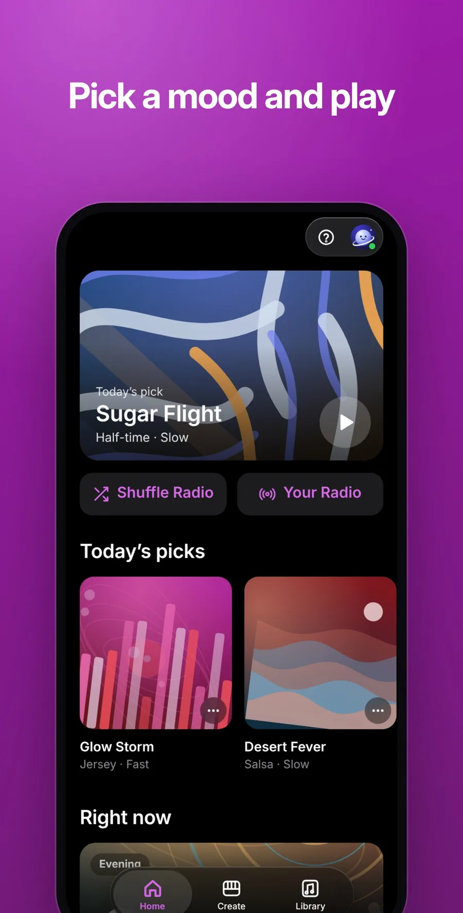
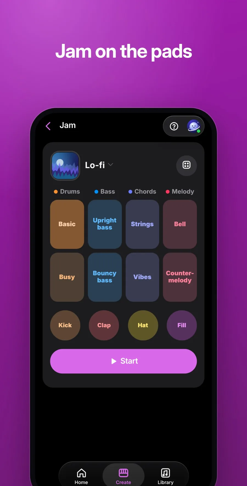
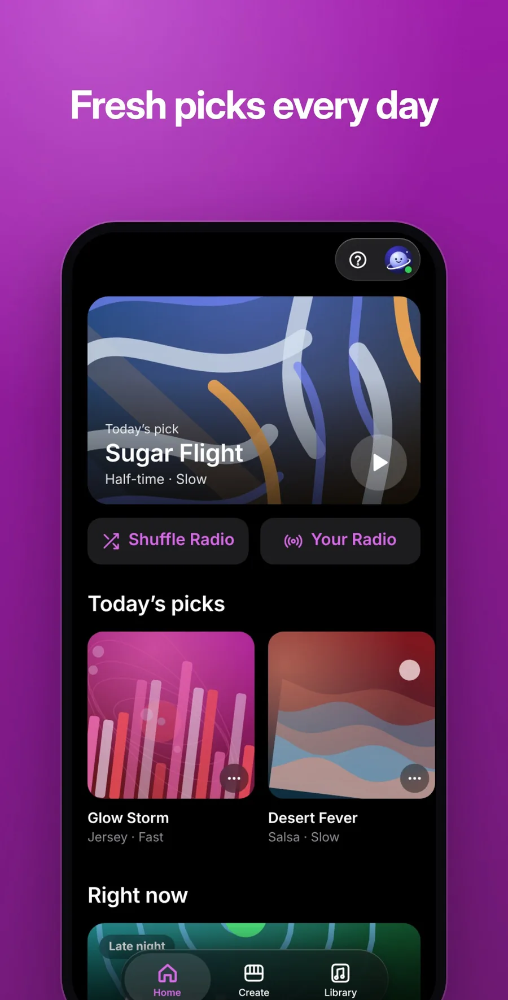

<p align="center">
  
</p>

<h1 align="center">Orbit Beats</h1>

<p align="center">
  <b>Make your own beats.</b><br>
  <a href="https://orbit.jaypengx.com/beats/"><b>orbit.jaypengx.com/beats</b></a>
</p>

<p align="center">
       
</p>

Music that never stops, and your own beat pieces arranged into new songs. Everything runs on the phone; no sound is uploaded. Part of **Orbit**, a family of phone apps for life in Taiwan that share one sign-in, the Orbit Pass. See them all at [orbit.jaypengx.com](https://orbit.jaypengx.com/pass/).

<p align="center">
  
  
  
</p>

<p align="center">
  
  
  
</p>

## Features

- **聽 Listen:** one play button and a mood (relaxed, energetic, groovy, classic, or one groove). Each song is written on the spot: a groove, tempo, key, chords, melodies, bass and drums, arranged into verses, hooks and a bridge and mixed, about two and a half minutes. It plays on with the screen locked, one song running into the next with no gap.
- **即興 Jam:** 16 coloured pads of a built-in band over a groove, or your own pieces as pads; record a take and it becomes a song.
- **樂器 Instruments:** a step grid of drums or notes on 42 instruments and 32 drum lanes, with accents, chords, swing, tap tempo, up to four sections chained, and MIDI out.
- **做歌 Make songs:** your recordings, a sample pack or the microphone, split on silences; the tempo, the role of each piece (riff, bass, hats, kick, 808…) and the key heard automatically; then full songs arranged in a real song form, each piece exactly as recorded.
- **節奏遊戲 Rhythm game:** every song is a level, its chart taken from the song's own notes, four lanes, four difficulties, playable with two thumbs.
- **資料庫 Library:** keep songs small (AAC), playlists, search, and export as WAV, stems, MIDI or a zip.
- **簡單 / 進階:** Simple mode for everyone, Advanced for every control, and 23 music words explained in everyday language.
- **Private:** everything runs on the phone; no sound is ever uploaded.

## Tech stack

| Layer | What |
| --- | --- |
| App | Plain JavaScript (ES modules), HTML and CSS; no framework, no build step, no dependencies |
| Audio | Synthesis and mixing in Web Workers, Web Audio, Media Source with WebCodecs' AudioEncoder (FLAC, AAC or Opus in MP4) for gapless play, one `<audio>` for the lock screen |
| Sounds | 32 recorded instruments from the MusyngKite soundfont, recorded drum kits (acoustic, TR-808, electronic, hand percussion), plus band-limited synth voices |
| Storage | IndexedDB for kept songs and kits on the phone; only settings go to the Orbit Pass |
| Shared | Look and Orbit Pass from the kit in [Orbit-Core](https://github.com/JayPengX/Orbit-Core) |
| Command line | `passion_beats.py` (Python 3, NumPy, SciPy): the same engine, kept in step with `engine.mjs` |
| Tests | `node --test` on the engine, the mix, variety, loudness and playability |

## How it works

```
pieces in (files, pack, mic) ─► split on silence ─► tempo · roles · key (analyze.mjs)
                                                         │
built-in band (radio.mjs) ─────────────────────────────► engine.mjs: song form, phrases, fills
                                                         │
                                                         ▼
                                     mix.mjs: buses, glue, room, loudness, limiter  (in a worker)
                                                         │
                                                         ▼
                                     player · library · WAV / stems / MIDI
```

- **Tempo:** every tempo from 70 to 190 BPM is scored by how well the hits sit on 16ths; on 100 made-up packs, 97% of tempos and 97.5% of roles come out right.
- **Variety by rule:** the next song never repeats a groove from the last six, jumps tempo or feel, and changes key, chords, lead and form; tests check 30 songs per mood.
- **Never silent by accident:** no quarter second of a radio song falls under -45 dBFS; the tests listen to twenty back to back.

The engine, the sounds and the decisions still in force: **[MAP.md](MAP.md)**.

## Project structure

```
public/
├── index.html, app.js       the page, tabs, player, library
├── engine.mjs               song planning and rendering (port of passion_beats.py)
├── analyze.mjs              hearing tempo and roles
├── lib/                     46 modules: radio, synth, voices, samples, mix, jam,
│                            studio, game, library, playlists, cover, tape, help
├── samples/                 recorded instruments (mk/) and drum kits (drums/)
└── sw.js
passion_beats.py             the same engine on the command line
scripts/                     samples, drums, listen, loudness
tests/                       node --test
MAP.md                       how it works
```

## Getting started

The app loads the shared kit from a sibling folder, so clone this repo next to [Orbit-Core](https://github.com/JayPengX/Orbit-Core):

```bash
git clone https://github.com/JayPengX/Orbit-Core.git
git clone https://github.com/JayPengX/Orbit-Beats.git
cd Orbit-Beats
```

Requirements: Node.js 22 or newer. There is nothing to install: no framework, no `node_modules`.

```bash
npm test   # links ../Orbit-Core/kit as .kit, then runs node --test
```

See it on a phone-sized screen, signed in with a made-up wallet and real data (needs Playwright):

```bash
# a screenshot, saved in /tmp/orbit-preview
node ../Orbit-Core/tools/preview.mjs beats --live --width 375
# serve it, then open http://localhost:8123/Orbit-Beats/
node ../Orbit-Core/tools/preview.mjs beats --live --serve --port 8123
```

`--dark`, `--lang en`, `--webkit` (Safari's engine) and the other flags are listed in [Orbit-Core/tools/README.md](https://github.com/JayPengX/Orbit-Core/blob/main/tools/README.md).

The command-line engine:

```bash
pip install numpy scipy
python3 passion_beats.py all_beats.wav --count 20 --out songs/
```

`node scripts/listen.mjs` writes songs to WAV to listen to; `node scripts/loudness.mjs` prints each groove's loudness.

## Deploying

Push to `main`. GitHub Actions runs the tests, stamps every file with its content hash (so a phone downloads only what changed) and publishes `public/` to GitHub Pages; the site Worker serves it at its orbit.jaypengx.com address. There are no pull requests or release branches.

## Credits

Recorded instruments from the MusyngKite soundfont (CC BY-SA 3.0); drum kits from Virtuosity Drums, a TR-808 sampled by Michael Fischer, and Sonic Pi (CC0). Full credits are in the app's ? sheet.

## Part of Orbit

| App | What it is |
| --- | --- |
| [Orbit Sports](https://github.com/JayPengX/Orbit-Sports) | Every game you can watch in Taiwan, live |
| [Orbit Transit](https://github.com/JayPengX/Orbit-Transit) | Bus, train, metro and YouBike, planned and navigated |
| [Orbit Weather](https://github.com/JayPengX/Orbit-Weather) | One clear forecast, to the township |
| [Orbit Words](https://github.com/JayPengX/Orbit-Words) | English vocabulary that stays |
| [Orbit Securities](https://github.com/JayPengX/Orbit-Securities) | A Taiwan broker on play money |
| [Orbit Class](https://github.com/JayPengX/Orbit-Class) | Today's classes at a glance |
| [Orbit Beats](https://github.com/JayPengX/Orbit-Beats) | Endless music and your own beats |
| [Orbit Law](https://github.com/JayPengX/Orbit-Law) | Laws, rulings and bills, linked |
| [Orbit Money](https://github.com/JayPengX/Orbit-Money) | Your own books |
| [Orbit-Core](https://github.com/JayPengX/Orbit-Core) | The kit, the Orbit Pass and the Workers behind them all |

How it was all built, in pictures and numbers: [jaypengx.com/showcase](https://jaypengx.com/showcase/).
